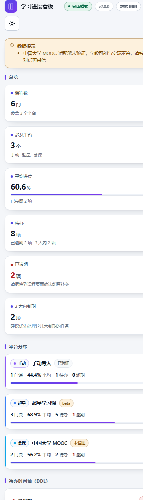

# studydash · 学习进度聚合看板

把**不同平台**的学习进度、作业与截止时间读出来，聚合成一个本地 HTML 看板。

课程散在超星、中国大学 MOOC、智慧树，作业又散在各自的公告和作业页里——这门课
进度到哪了、哪几个 DDL 快到了，没人替你算。studydash 把这些读到一个页面上：
整体进度、分项任务点、待办与逾期、DDL 时间轴、平台分布。


<details>
<summary>深色主题预览 / 移动端预览</summary>




</details>

---

## 这是什么，不是什么

**是**：一个只读的进度聚合器。它替你「看」，不替你「做」。

**只读承诺**（这条是硬约束，写进了代码而不是文档）：

- **平台流量的唯一出口是 `src/studydash/http.py`**，别处不许直接 `urllib`／`requests`。
  `studydash doctor` 会扫源码，有别的文件私自联网就报出来。
- 唯一的例外是 `src/studydash/cdp.py`：它用原始 socket 跟**本机**浏览器的调试端口
  （`127.0.0.1`）说话，用来把你自己登录好的会话读出来。这个例外是**逐文件白名单**的，
  而且白名单里的文件必须证明自己只连回环地址（`doctor` 会查它有没有 `127.0.0.1`
  这种主机常量、有没有出现任何网站 URL），不是「说了算」。
- **GET 可以打任何地址**（读列表页、读进度页）。
- **POST 只允许打到适配器显式声明的查询端点白名单**。慕课、智慧树这类平台的接口是
  RPC 风格（查询也用 POST 到 `*.rpc`），一刀切禁 POST 等于放弃这些平台；所以改成按
  **地址**判定：地址里出现 `submit` / `save` / `answer` / `commit` / `upload` /
  `create` / `delete` / `update` / `modify` / `doWork` / `finish` / `report` /
  `sign` / `checkin` / `signin` 这类写动作词，直接拒绝。
- 代码里**不存在**提交作业、交卷、答题、刷视频、签到、上报学习进度的调用。
- **不碰密码**。`studydash login` 开一个隔离浏览器窗口让你自己登录（扫码、验证码、
  二次验证都你自己过），它只从调试端口读登录后的 Cookie。账号密码它一个字符都看不到，
  也永远不会被写进任何文件。

**不是**：不是刷课工具，不是自动签到/自动答题，不是代做。v1 时期这个仓库是
超星单平台的看板；v2 重写为多平台聚合器，取的是「自己的进度自己看全」这一半。

---

## 快速开始

### 方式一：下载 exe（不用装 Python）

从 [Releases](../../releases) 下载，**两个包选一个就行**：

| 产物 | 说明 |
| --- | --- |
| `studydash.exe` | 单文件版，下载即用，约 9 MB。首次启动要解包，慢几秒 |
| `studydash-onedir.zip` | 文件夹版，解压后用里面的 `studydash.exe`，启动更快、更不容易被杀软误报 |

> 想固定一个下载链接，用 [最新版直链](../../releases/latest)，文件名不带版本号，所以
> `…/releases/latest/download/studydash.exe` 一直有效。

放进一个空文件夹**双击**即可：挑数据源 → 渲染 → 用默认浏览器打开看板，并在同目录生成：

```
你的文件夹/
├── studydash.exe
├── config.json         ← 想接自己账号时，把 config.example.json 复制成这个
├── crash.log           ← 只在崩溃时出现
├── data/progress.json  ← 聚合结果
└── out/dashboard.html  ← 看板
```

> 如果单文件版双击「黑框一闪就消失」，换文件夹版。崩溃时 `crash.log` 会记下原因，
> 仓库还应有一份弹窗提示。也欢迎提 issue 附上 `crash.log`。

### 方式二：pip 安装

```bash
pip install git+https://github.com/zhihang64/studydash
studydash demo --open
```

### 方式三：源码跑（开发）

```bash
git clone https://github.com/zhihang64/studydash
cd studydash
pip install -e ".[dev]"      # 只有测试/打包时才需要依赖；运行本身零依赖
studydash demo --open        # 或： python -m studydash demo --open
```

**运行时零第三方依赖**，只用标准库——见下面「设计取舍」。

### 30 秒看效果（不联网）

```bash
studydash demo --open
```

内置 6 门课 / 10 条作业的样例数据，覆盖已逾期、今天到期、远期、无截止、已评分等
各种状态，用来确认看板本身跑得通。不联网、不需要账号。

---

## 接上你自己的账号

### 一条命令：登录，然后直接看到你的学业页面

```bash
studydash login
```

它会**新开一个属于自己的浏览器窗口**（用独立的临时配置档，不碰你日常那个浏览器，
所以你不用关掉正在用的 Edge/Chrome），停在超星登录页。你在里面正常登录——账号密码、
手机验证码、扫码，都你自己过，程序一个字符都看不到。

登录成功后命令行会自己往下走：**读会话 → 抓课程和作业 → 渲染 → 打开看板**。
也就是说，登录完你面对的就已经是学业总览页面了。

```text
▸ 打开浏览器，请在里面完成登录（登录完成后不用管，程序会自己继续）
  · 配置档：C:\Users\you\AppData\Local\Temp\studydash-login-xxxx
  · 登录页：https://i.chaoxing.com/base
✓ 拿到会话（3 条超星 Cookie，已确认有效）
✓ 保存到 config.json（账号：默认（1234567））
  ✓ 超星学习通：12 门课
  共 12 门课 / 1 个平台，平均进度 41.3%
  待办 6 项（逾期 1 · 三天内 2），已完成 9 项
```

### 四条取会话的路，挑一条走

| 来源 | 命令 | 什么时候用 |
| --- | --- | --- |
| 隔离窗口 | `studydash login` | **首选**。不用关你日常的浏览器，不用手抄 Cookie |
| 读日常配置档 | `studydash login --source browser` | 你已经在日常浏览器里登录好了。注意：**要先完全退出那个浏览器**（Chromium 对 Cookie 库持有独占锁，不是程序不给力） |
| 扩展/工具导出 | `studydash login --file cookies.json` | 浏览器换成 Sora/其他不支持的新格式，或上面两种都不行。吃 Netscape `cookies.txt` 和常见扩展导出的 JSON |
| 手动粘贴 | `studydash login --cookie "_uid=..."` | 兜底。F12 → Network → 任一请求 → Request Headers → 整条 `Cookie` |

四条路都会**立刻验证**会话是否真的有效，不会把死 Cookie 写进配置然后让你自己发现。
不想让它自动接着抓取，加 `--no-fetch`；只想存不想验证，加 `--no-check`。

### 超星学习通（status: beta）

`login` 之外，也可以纯命令行把 Cookie 塞进 `config.json`：

```bash
studydash init            # 生成 config.json（含注释字段）
studydash probe chaoxing  # 只读探测，原始响应存到 data/raw/，先确认能通
studydash fetch           # 抓课程与进度
studydash build --open    # 渲染 + 打开
```

想让看板也显示章节任务点（视频/阅读/测验），把 `options.chapters` 打开：

```json
"options": { "chapters": true, "max_chapters": 40 }
```

这条路径是实验性的，可能被平台改版打断，所以超星标注为 `beta`。

**抓不到课程时不要猜。** `studydash fetch` 会直接告诉你它看到了什么：

```text
× 超星学习通: 课程列表解析结果为空
  诊断：响应 34521 字节；正文看起来是登录页（Cookie 没生效）。
  → 跑 `studydash probe chaoxing` 把原始响应留档下来（data/raw/）
```

这几句话就能分清三种情况：Cookie 失效、账号确实没课、平台改版了。


### 手动导入（最稳，推荐作为兜底）

抓取失败、平台没适配、线下课、教务系统——都可以手工喂进来：

```bash
studydash import --init              # 生成 data/manual.json 模板
studydash import D:\path\mine.json   # 或 .csv，然后直接渲染
```

JSON 里每门课可以带自己的 `platform` / `platform_name`，所以线下课也能打上
「教务系统」的标：

```json
{
  "courses": [
    {
      "id": "x1", "name": "形势与政策（线下）",
      "platform": "manual", "platform_name": "教务系统",
      "assignments": [
        { "id": "a1", "title": "课程论文提纲", "kind": "homework",
          "status": "pending", "due": "2026-11-01 23:59" }
      ]
    }
  ]
}
```

截止时间支持 `2026-11-01 23:59` / `2026-11-01` / `2026年11月1日` / `11-01 23:59` /
unix 时间戳。

### 平台适配器状态

| id | 平台 | 状态 | 鉴权 | 说明 |
| --- | --- | --- | --- | --- |
| `chaoxing` | 超星学习通 | beta | Cookie | 课程与进度已验证；章节任务点为实验性 |
| `icourse163` | 中国大学 MOOC | **未验证** | Cookie | 按接口形状写的，字段可能与实际不符 |
| `zhihuishu` | 智慧树 | **未验证** | Cookie | 同上 |
| `manual` | 手动导入 | stable | 无 | JSON / CSV，可给任意平台打标 |
| `demo` | 离线演示 | stable | 无 | 内嵌样例，不联网 |

状态含义：

- **stable** — 不依赖外部平台，或有人用真实账号跑通过。
- **beta** — 主流程通过，附加功能可能被平台改版打断。
- **未验证** — 照接口形状写的，**字段可能与实际不符，请核对后再采信**。未验证的
  平台会在看板顶部挂一条提示，不会装作没问题。

`studydash platforms` 随时看这张表（含最近验证日期）。

---

## 命令

| 命令 | 作用 |
| --- | --- |
| *（不带子命令）* | 一键：有 Cookie 就抓、否则用已有数据或演示数据，渲染后打开浏览器 |
| **`login`** | **登录并把会话存起来**：默认开隔离浏览器窗口；`--source browser/file/cookie` 换来源；默认登录后直接抓取＋渲染＋打开 |
| `init` | 生成 `config.json`（已有则不覆盖，要重建加 `--force`） |
| `demo` | 内置样例数据 → payload → 渲染 |
| `platforms` | 列出所有适配器及其状态 |
| `probe [id]` | 只读探测接口可用性，原始响应对应存到 `data/raw/` |
| `fetch` | 用配置里的 Cookie 抓取各平台 |
| `import FILE` | 从 JSON / CSV 导入（`--init` 生成模板） |
| `build` | `data/progress.json` → `out/dashboard.html` |
| `open` | 用默认浏览器打开已生成的看板 |
| `serve --port 8787` | 本地起 http 服务预览 |
| `all [--demo]` | 抓取（或 demo）+ 渲染 |
| `config` | 打印配置（Cookie 已脱敏） |
| `doctor` | 自检：环境、工作区、模板、只读性扫描 |
| `version` | 版本与 payload schema 版本 |

通用参数：`--home DIR` 指定工作区，`-v/--verbose`，`-q/--quiet`，`--version`。

`login` 的完整参数：

| 参数 | 说明 |
| --- | --- |
| `--source live\|browser\|file\|manual` | 会话来源，默认 `live`（隔离窗口） |
| `--browser edge\|chrome` | 用哪个浏览器，默认 `edge` |
| `--profile NAME` | 指定配置档（`--source browser` 时用），默认 `Default` |
| `--file PATH` | `--source file` 时的 cookies.json / cookies.txt |
| `--cookie TEXT` | `--source manual` 时的整条 Cookie |
| `--label NAME` | 存进 `config.json` 时的账号名，默认自动（`默认（uid）`） |
| `--no-check` | 跳过会话验证（不推荐） |
| `--no-save` | 不写 `config.json` |
| `--no-fetch` | 存完就停，不接着抓取渲染 |
| `--open` | 渲染完顺手打开浏览器 |

`probe` 输出的是**存档**（`data/raw/*.json` 里有请求记录与原始响应），用于平台改版时
定位解析问题，不是用来绕过限制的。

---

## 看板能看到什么

- **总览**：课程数、涉及平台、平均进度、待办数、已逾期、3 天内到期。
- **平台分布**：每个平台多少门课、平均进度、待办、逾期；取不到数据的平台会说明原因。
  点平台卡或筛选 chips 可以只看某个平台。
- **DDL 时间轴**：全部待办按 已逾期 / 3 天内 / 7 天内 / 以后 / 无截止 / 已完成 分组。
- **课程卡**：总百分比、分项进度条（任务点 / 作业 / 出勤…随数据源变化）、
  最近活跃、下一项截止、已完成项数，可展开作业明细（含分数与剩余天数）。
- 搜索（课程 / 教师 / 标题）、排序、深浅色主题、键盘可操作、响应式。
- **静态单文件**：模板里已内嵌数据，`file://` 直接打开就能用，零 CDN、零外部请求。
  主题可用链接强制：`out/dashboard.html#dark`、`#light`。

---

## 数据结构与契约

前端消费的 payload 形状见 [`docs/payload.example.json`](docs/payload.example.json)
（带注释版样例）。顶层六个键：

```
meta      { version, generated_at, mode, readonly, theme, warnings[] }
overview  { courses, platforms, avg_progress, pending, overdue, due_soon, done }
platforms [{ id, name, short, status, status_label, color, courses, ... }]
timeline  [ Assignment ]   // 已按 due 升序
courses   [{ platform, name, progress_parts[], assignments[], ... }]
accounts  [{ platform, label, ok, message, fetched_at }]
```

`data/progress.json` 就是这个 payload，所以 `build` 单独跑得起来、可以手工编辑、
也可以拿它当别的工具的数据源。枚举：`kind` ∈ video/read/quiz/homework/exam/
discussion/live/other；`state` ∈ overdue/urgent/soon/later/none/done。

`render` 注入 payload 时会转义 `<`、`&`、U+2028/U+2029，课程名里带 HTML 也注入不出去；
前端全部走 DOM API + `textContent`，不用 `innerHTML` 拼字符串。

---

## 写一个适配器

适配器是插件：放进 `src/studydash/providers/` 就自动被发现，或者打包成第三方包通过
`entry_points` 挂进来，**不用改本仓库一行代码**：

```toml
[project.entry-points."studydash.providers"]
my-university = "my_pkg.provider:CampusProvider"
```

最小实现（详见 [`docs/plugin.md`](docs/plugin.md)）：

```python
from studydash.model import Assignment, Course, Progress
from studydash.providers.base import Provider, ProviderMeta, register


@register
class CampusProvider(Provider):
    meta = ProviderMeta(
        id="campus", name="本校教务", short="教务",
        status="unverified", color="#f59e0b", auth="cookie",
        note="按接口形状写的，待真实账号验证",
    )

    def fetch(self) -> list[Course]:
        self.require_cookie()
        html = self.http.get_text("https://jw.example.edu/my/courses")
        ...
```

RPC 风格平台继承 `RpcProvider`，用 `endpoints` 声明 POST 白名单、`queries` 声明查询，
基类负责「逐个试、解析为空就换下一个、全空就告警」。

**三条自律**：只读；只收 Cookie 不收账号密码；失败要响——平台改版就让 `fetch` 抛
`ProviderError`，不要在 `meta` 里假装没事。

---

## 目录

```
studydash/
├── src/studydash/
│   ├── cli.py           命令行入口与子命令
│   ├── model.py         统一数据模型 + 派生计算（分类、排序、日期解析）
│   ├── http.py          唯一网络出口（只读白名单在这里）
│   ├── htmlx.py         极简 HTML 解析器（替掉 lxml 依赖）
│   ├── store.py         工作区、配置、模板查找、原子写
│   ├── aggregate.py     逐平台抓取 → 聚合 → payload
│   ├── render.py        注入 payload，转义
│   ├── log.py           零依赖日志
│   ├── templates/dashboard.html   看板模板（单文件自包含）
│   └── providers/       适配器：chaoxing / icourse163 / zhihuishu / manual / demo
├── tests/               192 个用例（pytest）
├── docs/                payload 契约、插件文档、预览图
├── tools/               图标生成、PyInstaller 入口、打包脚本、版本资源模板
├── assets/              icon.png / icon.ico（由 tools/make_icon.py 生成）
├── config.example.json  配置样例
└── pyproject.toml
```

> 从 v1（`chaoxing-dashboard`）升上来的话：仓库已改名，单文件 `dashboard.py` 被
> `src/studydash/` 包取代，旧的 `data/progress.json` schema 也换了，重新 `fetch`
> 或 `import` 一次即可。

---

## 设计取舍

**为什么是 Python。** 目标形态是「一个能双击运行的小工具 + 可 pip 安装的库 + 社区
能直接改的适配器」。Python 三样都顺：标准库自带 HTTP、HTML 解析、JSON、argparse；
PyInstaller 出单文件；适配器就是几十行的类，谁都能写一个 PR。

**为什么零第三方运行时依赖。** 单文件分发最怕原生依赖（`lxml` 的 wheel、
`cryptography` 的 DLL 之类），一是体积，二是杀软误报，三是 Python 版本一换就崩。
所以自带一个小 HTML 解析器（`htmlx.py`，基于 `html.parser`），不引 `requests`、
不引 `lxml`。代价是解析器不如 lxml 健壮——用宽松容错 + 正则兜底覆盖实际页面形状，
真遇到怪页面就 `probe` 存档再补规则。

**为什么 POST 白名单按地址判定。** 见开头「只读承诺」。

**为什么模板不引 CDN、不用构建工具。** 看板要能在没网的机器上、从 `file://`
直接打开，还要能当附件发给别人。所以模板是单个 HTML，全部内联，零外部请求。

---

## 打包

```bash
python -m pip install pillow pyinstaller
pwsh -File tools\build_exe.ps1              # 默认同时出 onedir 和 onefile
pwsh -File tools\build_exe.ps1 -Mode onedir # 只出文件夹版
```

脚本会先画图标（纯代码绘制，无需外部素材），再用 `tools/entry.py` 打包，最后打印
体积、SHA256 和版本资源。

> 打包踩坑：PyInstaller 一旦指定 `--specpath`，`--icon` / `--add-data` /
> `--version-file` 都会相对 **spec 所在目录**解析，必须传绝对路径，否则报
> `Unable to find ...\build\templates`。

## 测试

```bash
python -m pytest          # 192 个用例
python -m ruff check .    # 可选：装了 lint 依赖
```

用例覆盖：数据模型与派生计算、HTML 解析器、只读网络层（含白名单拒绝路径）、
工作区与配置脱敏、聚合的失败隔离、渲染转义、适配器注册表、CLI 子命令契约。

---

## 版本与发布

当前版本 **v2.0.0**，更新内容见 [CHANGELOG.md](CHANGELOG.md)。

**版本号只有一处源头**：`src/studydash/__init__.py` 的 `__version__`。
`pyproject.toml` 动态读它，exe 的 Windows 版本资源由
`tools/version_info.tmpl.txt` 在打包时渲染成 `build/version_info.txt`——
不再有「三处手改走样」的问题。

发版：

```bash
git commit -am "chore: 升到 v2.1.0"
git tag -a v2.1.0 -m "v2.1.0"
git push origin main v2.1.0
```

推 `v*` 标签会触发 [`.github/workflows/build-exe.yml`](.github/workflows/build-exe.yml)：
在 windows-latest 上跑测试 → 打包两种产物 → 在干净目录做冒烟测试 → 挂到同名 Release。
手动触发（workflow_dispatch）只出 artifact，不发 Release。

---

## 已知限制

- **两个适配器未验证**（`icourse163` / `zhihuishu`）。字段是照接口形状写的，可能对不上。
  看板会给它们挂提示，不会假装数据可信。欢迎拿 `probe` 的存档提 issue 修正。
- **超星的课程列表解析没有真实账号复验过**。逻辑来自 v1 时期能跑通的那版列表页结构，
  v2 加了登录能力之后还没拿真账号端到端跑过——所以超星标 `beta`，所以解析失败时它会
  把「响应多少字节、是不是登录页、有没有 `courseList`、里面几个 `<li>`」直接打出来。
  如果你跑出来是空的，把那四句话贴到 issue，适配器当天就能修。
- **超星的章节任务点**是实验性的（`options.chapters`）。
- **列表页通常只给总百分比**，不给分项任务点数，也不给 DDL。这类数据要看板显示，
  得靠手动导入补——把散落各处的 deadline 拢到一处，本身就是这个工具最值钱的部分。
- **静态看板**：数据在渲染时内嵌，刷新页面不会重新抓取；更新要重跑 `build`/`fetch`。
- exe 未做代码签名，SmartScreen 可能提示未知发布者；未适配 macOS/Linux 的打包。

## 隐私

`config.json` 含登录 Cookie，`data/` 含你账号的页面原文，`out/` 含课程名与 uid。
三者都在 `.gitignore` 里，绝不提交。`studydash config` 输出默认脱敏，
`Config.to_dict(redact=True)` 会把 cookie/token/password/secret/authorization
换掉。分享看板 HTML 前留意它内嵌了你的课程与账号信息。

**关于读浏览器 Cookie**（`studydash login` 的 `live` / `browser` 两种来源）：

- 必须你在命令行点名浏览器才会读，**没有后台扫描**。不带 `--source` 时它开的是
  一个临时隔离配置档，读完即弃。
- 默认只挑 `*.chaoxing.com` / `*.chaoxing.cn` 的 Cookie，其他站的**不取**。
- 读的是数据库的**副本**（先复制到临时目录再只读打开），不修改浏览器的任何数据。
- 解密用的是 Windows 的 DPAPI：密钥由**你的登录凭据**保护，所以这份数据只有在你
  自己的用户会话里才能解开——换个用户或换台机器就是一堆密文。
- Cookie 值只出现在内存和 `config.json` 里，**不写日志**（`Cookie.as_dict()` 故意只给
  长度不给值）。`--verbose` 也不会把值打出来。
- Chrome 127+ 的 app-bound 加密（`v20`）读不了，会明确报错并给出替代路径，不会
  悄悄失败。

一切都在本地：程序不向任何第三方服务器发送数据，也不上传你的进度。唯一的外部流量
是去各平台读你自己的课程页面——和你自己打开浏览器看是同一件事。

## License

[MIT](LICENSE)
