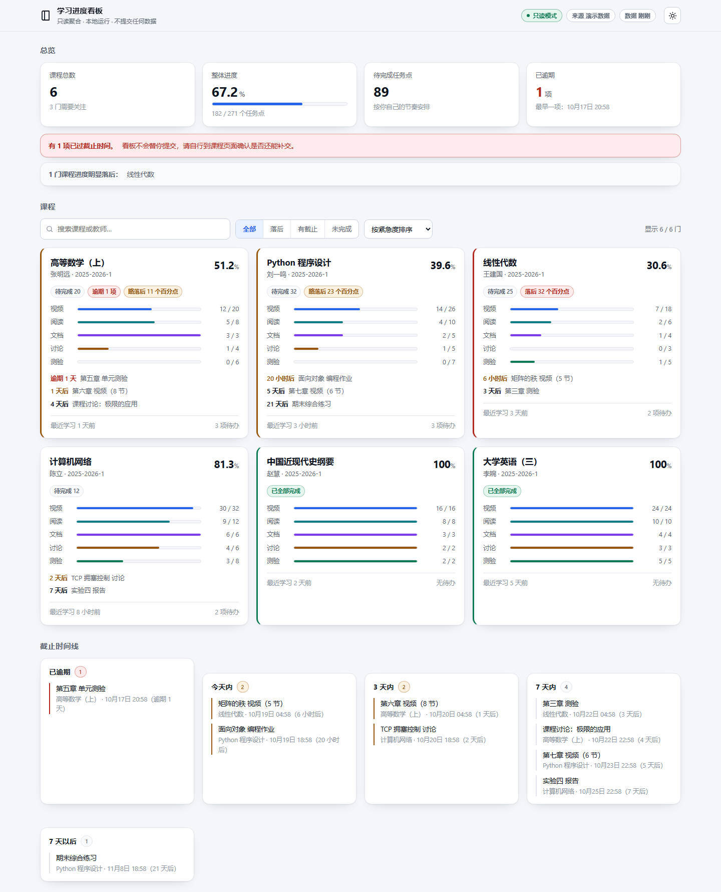
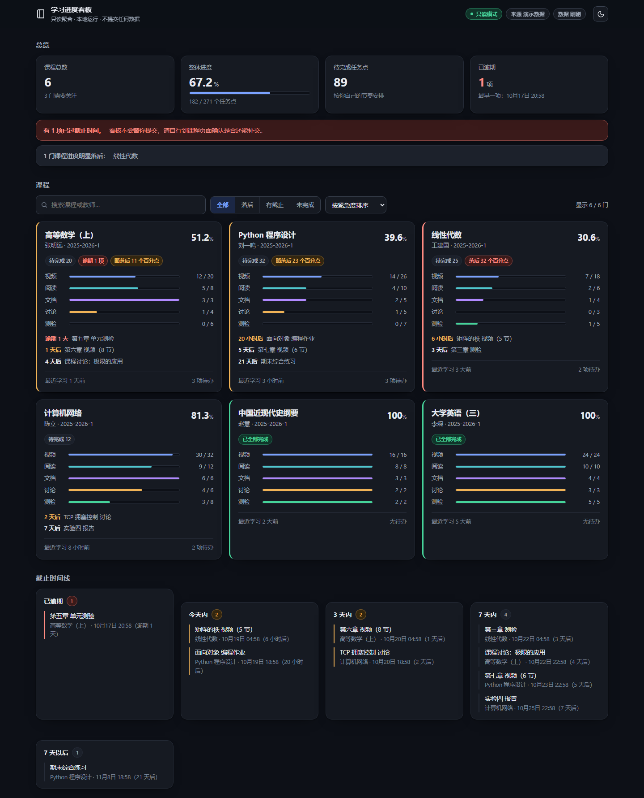

# 学习进度聚合看板（只读）

把你自己的学习进度读出来，聚合成一个本地 HTML 看板：整体进度、待完成任务点、
临近截止、进度落后预警。

**只读**：本程序只发出 HTTP GET 去读课程列表页，代码里没有任何进度上报、
任务点提交、签到、答题之类的写接口调用。看板不会代做、不会提交、不会改动任何任务状态。

**零依赖**：只用 Python 标准库，不需要 `pip install`。



<details>
<summary>深色主题预览</summary>



</details>

---

## 直接用可执行文件（不用装 Python）

从 [Releases](../../releases) 下载 `chaoxing-dashboard-v1.0.0.exe`
（GitHub 的附件名不支持中文，所以是 ASCII 名；程序内部的原始文件名仍是 `学习进度看板.exe`，
下载后可以随便改名，不影响运行）。放进任意空文件夹，**双击**即可：
它会自动挑数据源 → 渲染 → 用默认浏览器打开看板，并在同目录生成：

```
你的文件夹/
├── 学习进度看板.exe
├── config.json        ← 想接自己账号时，把 config.example.json 复制成这个
├── data/progress.json ← 数据
└── out/dashboard.html ← 看板
```

单文件约 **8.6 MB**，PyInstaller onefile，零运行时依赖，Windows x64。

命令行用法和源码版完全一致：

```bat
学习进度看板.exe                  :: 一键：选数据源 → 渲染 → 打开浏览器
学习进度看板.exe all --demo       :: 强制用演示数据
学习进度看板.exe --refresh        :: 已有数据也重新只读抓取
学习进度看板.exe --no-open        :: 只生成，不弹浏览器（脚本里用）
学习进度看板.exe build --out X.html
学习进度看板.exe --version
```

## 30 秒看效果（源码跑）

```bat
cd /d "D:\DSH chat\chaoxing_dashboard"
python dashboard.py all --demo
start "" out\dashboard.html
```

`--demo` 用内置的 6 门示例课程，无需登录，用来确认看板本身跑得通。

## 换成你自己的真实进度

### 方式 A：只读抓取（推荐先 `probe` 探一下）

```bat
copy config.example.json config.json
python dashboard.py probe            :: 只读探测接口是否可用，原始响应存到 data/raw/
python dashboard.py fetch            :: 抓取并生成 data/progress.json
python dashboard.py build            :: 渲染 out/dashboard.html
```

`config.json` 里的 `cookie` 从浏览器开发者工具复制：登录后按 F12 → Network →
随便点一个请求 → Request Headers → 整条 `Cookie` 复制过来。

`config.json` 含登录态，**别提交到任何仓库**（本目录已带 `.gitignore`）。

### 方式 B：离线导入（抓取失败时的兜底）

浏览器打开课程列表页 → 另存为 HTML → 转换：

```bat
python dashboard.py import --html D:\path\to\保存的页面.html
python dashboard.py build
```

### 方式 C：手工维护

直接编辑 `data/progress.json`，字段见下面的数据结构。想让演示数据变成你的起点：

```bat
python dashboard.py demo
:: 然后编辑 data/progress.json，把课程名、任务点数改成你自己的
python dashboard.py build
```

---

## 命令

| 命令 | 作用 |
| --- | --- |
| *（不带子命令）* | 一键模式：有 Cookie 就抓、否则用已有数据或演示数据，渲染后打开浏览器 |
| `demo` | 生成演示数据到 `data/progress.json` |
| `probe` | 只读探测接口可用性，原始响应落盘到 `data/raw/` |
| `fetch` | 用你自己的 Cookie 只读抓取课程列表 |
| `import --html FILE` | 从浏览器另存的页面离线转换 |
| `build` | `data/progress.json` → `out/dashboard.html` |
| `serve --port 8787` | 本地起 http 服务预览 |
| `all [--demo]` | 抓取（或 demo）+ 渲染 |

通用参数：`-v/--verbose` 打印解析细节，`--data` 指定数据文件，`--out` 指定输出，
`--config` 指定配置文件，`--no-open` / `--refresh` 只对一键模式生效，`--version` 看版本。

---

## 看板能看到什么

- **总览**：课程数、整体进度、待完成任务点总数、最近截止 / 已逾期项。
- **课程卡**：每门课的总体百分比，以及视频 / 阅读 / 文档 / 讨论 / 测验分项进度条，
  最近学习时间、待办数量、最多 3 条最近截止。
- **落后预警**：用学期时间轴和你登记的开始/结束日期，算「时间过去了多少 vs 你学了
  多少」，落差 ≥10 个百分点标「略落后」，≥25 标「落后」。
- **截止时间线**：把全部待办按 已逾期 / 今天内 / 3 天内 / 7 天内 / 7 天以后 分组。
- **筛选与排序**：搜索课程或教师，按「全部 / 落后 / 有截止 / 未完成」筛选，
  按紧急度、落后程度、进度、最近截止、课程名排序。
- 深浅色主题、`prefers-color-scheme` 跟随、键盘可操作、打印友好。

---

## 数据结构（`data/progress.json`）

```jsonc
{
  "schema": 1,
  "generated_at": "2025-12-01T20:00:00+08:00",
  "source": "demo",                    // demo | chaoxing | import
  "read_only": true,
  "account": { "name": "", "uid": "" },
  "term": { "name": "", "start": "", "end": "" },   // 留空则不显示落后预警
  "notes": ["说明文字"],
  "courses": [
    {
      "id": "900001",
      "class_id": "550001",
      "cpi": "230001",
      "name": "高等数学（上）",
      "teacher": "张明远",
      "term": "2025-2026-1",
      "url": "https://mooc1.chaoxing.com/mycourse/studentstudy?courseId=...",
      "progress": {
        "video":      { "done": 12, "total": 20 },
        "read":       { "done": 5,  "total": 8 },
        "document":   { "done": 3,  "total": 3 },
        "discussion": { "done": 1,  "total": 4 },
        "quiz":       { "done": 0,  "total": 6 }
      },
      "last_study_at": "2025-11-30T22:10:00+08:00",
      "deadlines": [
        {
          "task": "第五章 单元测验",
          "kind": "quiz",              // video|read|document|discussion|quiz|other
          "due": "2025-12-02T23:59:00+08:00",
          "status": "pending"          // pending | done
        }
      ]
    }
  ]
}
```

`progress` 里的分类可以任意增减——看板自动适配。`build` 会先跑一遍校验，
补齐缺字段，所以手工写的 JSON 只要大致对就能渲染。

---

## 目录

```
chaoxing_dashboard/
├── dashboard.py               主程序（一键 / demo / probe / fetch / import / build / serve）
├── config.example.json        配置样例，复制成 config.json 用
├── templates/dashboard.html   看板模板（含 /*__BOOT__*/ 注入点）
├── assets/icon.{png,ico}      应用图标（由 tools/make_icon.py 生成）
├── tools/
│   ├── make_icon.py           纯代码画图标，不依赖外部素材
│   ├── version_info.txt       exe 的 Windows 版本资源
│   └── build_exe.ps1          一键打包（图标 + exe + 体积 + SHA256）
├── tests/
│   └── fixture_course_list.html   本地测试样例，用来验证导入解析
├── docs/preview-*.png         预览图
├── LICENSE                    MIT
├── CHANGELOG.md               更新日志
├── data/                      运行后生成：progress.json + raw/（已在 .gitignore）
└── out/dashboard.html         运行后生成（已在 .gitignore）
```

想改样式只改 `templates/dashboard.html` 里的 CSS 变量，然后 `build` 即可。
主题也可以用链接强制：`out/dashboard.html#dark`、`#light`。
exe 旁边放一份 `templates/dashboard.html` 会优先使用它，方便不改程序就换皮肤。

### 自己打包 exe

```bat
python -m pip install pillow pyinstaller
pwsh -File tools\build_exe.ps1
```

脚本会先画图标再打包，最后打印体积、SHA256 和版本资源。改版本号时同步改
`dashboard.py` 的 `__version__`、`tools/version_info.txt` 和 `CHANGELOG.md`。

> 打包踩坑：PyInstaller 一旦指定 `--specpath`，`--icon` / `--add-data` / `--version-file`
> 都会相对 spec 所在目录解析，必须传绝对路径，否则报
> `Unable to find ...\build\templates`。

### 自测

```bat
python dashboard.py import --html tests\fixture_course_list.html --data data\_t.json -v
python dashboard.py build  --data data\_t.json --out out\_t.html
```

样例里有 4 个 `<li>`（其中 1 条重复），预期解析出 3 门课程、2 位教师正确归属。

---

## 版本与发布

当前版本 **v1.0.0**，更新内容见 [CHANGELOG.md](CHANGELOG.md)。

版本号在三处同步，改版本时一起改：

1. `dashboard.py` 的 `__version__`
2. `tools/version_info.txt`（exe 的 Windows 版本资源）
3. `CHANGELOG.md`

发版流程：

```bat
git commit -am "chore: 升到 v1.1.0"
git tag -a v1.1.0 -m "v1.1.0"
git push origin main v1.1.0
```

推 `v*` 标签会触发 [`.github/workflows/build-exe.yml`](.github/workflows/build-exe.yml)：
在 windows-latest 上打包 exe → 在干净目录跑一次一键模式冒烟测试 → 上传 artifact →
挂到同名 Release。手动触发（workflow_dispatch）则只出 artifact，不发 Release。

本地打包用 `pwsh -File tools\build_exe.ps1`，和 CI 走的是同一个脚本。

---

## 已知限制

- **抓取层需要你的账号验证**。`config.json` 里的 `endpoints.course_list` 是按已知的
  只读列表页写的；平台改版后解析会失败，此时 `data/raw/course_list.html` 会保留原始
  响应，配合 `-v` 看匹配情况调整 `parse_html_course_list()` 即可，或直接用方式 B 兜底。
- **任务点细分进度**（视频/阅读/文档各多少）不一定在列表页里。列表页通常只有总百分比，
  这种情况下看板会把该课程显示为「无任务点数据」或只有一项总体进度；要细分需在
  `progress.json` 里手工补，或有额外数据源。
- **截止时间**取决于数据源是否提供。列表页一般不给，需要手工在 `deadlines` 里登记——
  这也正是这类看板最有价值的部分：把散落各处的 deadline 自己拢到一处。
- 看板是**静态**的：数据在渲染时内嵌，刷新页面不会重新抓取。更新数据要重跑 `build`。

## 隐私

`config.json` 含登录 Cookie，`data/raw/` 含你账号的页面原文。两者都在 `.gitignore` 里。
分享看板 HTML 前留意：`out/dashboard.html` 内嵌了你的课程名、教师名和 uid。
